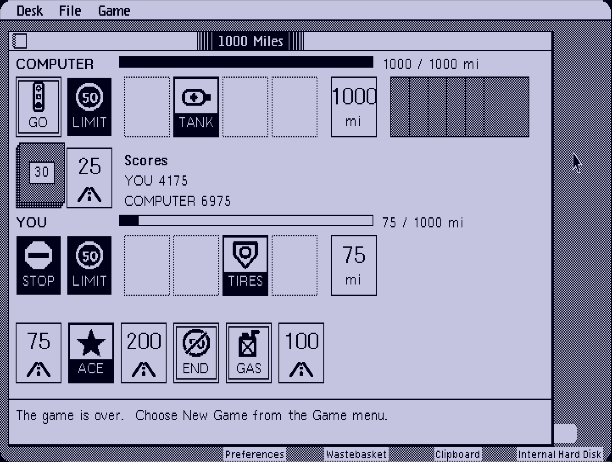

# 1000 Miles

A road-race card game for the **Apple Lisa Office System 3.0**: you against the computer, first to a thousand miles.
It installs as an Office System tool, written in Lisa Pascal, with original card art drawn for the Lisa's tall pixels.



It is a race game in the style of the classic French card game. 

## Install

1. Get `1000-miles.dc42` from the release page. It is a 400 KB Lisa floppy image.
2. Put it on a floppy, a Floppy Emu or an ESFloppy card, or insert it in LisaEm (File > Insert diskette).
3. In the Office System, open the floppy and drag the **1000 Miles** icon onto your hard disk. Open it from there.

Tested: LisaEm (Office System 3.0), installing from the floppy onto a clean system and playing; a LisaFPGA (2 MB,
built and run from source). **Not yet tested:** the floppy on real drives or on a LisaFPGA floppy emulator.
The tool is "document-less": double-click it to play.

## How to play

Be first to travel exactly 1000 miles. Each turn: **draw** (click the draw pile), then **play or discard** a card.
You hold six cards. A game is a series of matches; the first running total to reach **5000** wins the game.

| Cards | What they do |
|---|---|
| **Distance** 25, 50, 75, 100, 200 | Play on your own side to move. You need a **Go** first. Only two 200s per match. |
| **Hazards**: Accident, Out of Gas, Flat Tire, Stop, Speed Limit | Play on the computer's side to stop it. A hazard needs a car that is moving (Speed Limit works on any car). |
| **Remedies**: Repairs, Gasoline, Spare Tire, Go, End of Limit | Fix a hazard on your own side. Go starts you, and restarts you after a Stop. |
| **Safeties**: Ace Driver, Extra Tank, Tough Tires, Right of Way | Protect you from a hazard for good. Playing one gives you **another turn**. |

- **Coup fourre.** If the computer plays a hazard and you hold its safety, you can play it at once: the hazard is
  undone, you draw a replacement card and take your normal turn, and you score 300 on top of the safety's 100.
- **The 700-mile rule.** You can't pass 700 until you extend: land on exactly 700, then choose **End Game** (the trip
  counts, the match ends) or **Continue** (go for 1000, +200 if you finish). Once either player extends, nobody is asked
  again. The computer extends only when it is well ahead.
- **Endgame.** When the draw pile is empty there is no more drawing; a player with nothing to play is skipped, and the
  match ends when neither can play.

| Scoring | Points |
|---|---|
| Miles travelled | 1 per mile |
| Each safety played | 100 |
| Coup fourre (each) | +300 |
| All four safeties | +300 |
| Trip completed | +400 |
| Trip finished after the draw pile ran out | +300 |
| Trip with no 200-mile cards | +300 |
| Shutout (opponent never moved) | +500 |
| Extension: finished 1000 after going on from 700 | +200 |

### Controls
- **Click** a card to select it. Every place it can legally go lights up (your piles, the computer's piles, the discard
  pile). Click one to play.
- **Double-click** a card to play it where it belongs. A double-click never discards.
- **Drag** a card onto a lit spot. Drop it anywhere else and it stays selected.
- A dotted outline in your hand shows the open place while you are to draw. The status line under the table says what
  to do next, and what any selected card does.
- **Game > New Game** resets all scores; **Next Match** (the button between matches) deals again and keeps them.
  **Game > How to Play** repeats the rules. File: Set Aside Everything, Set Aside "1000 Miles", Save & Put Away.

## Build from source

The Mac side tests the rules; the Lisa side builds the tool. See [docs/lisa-build.md](docs/lisa-build.md) for the whole
flow (LisaEm, a real Lisa or LisaFPGA, installing, the icon, making the floppy).

```
make all     # 253 rules checks, 212 UI checks, 35 icon checks, a 6000-game simulation, and lint rules
```

How it is laid out:

| Path | What it is |
|---|---|
| `src/MILES-LOGIC.TEXT`, `-LAYOUT`, `-CTRL`, `-ICONS` | Portable Pascal: rules and computer opponent, table geometry, click/turn controller, card icons. Compiled by both Free Pascal (tests) and Lisa Pascal. |
| `src/MILES-GLOBALS`, `-DRAW`, `-MAIN` | Lisa-only: shared state and clock, QuickDraw rendering, the event loop and menus. |
| `src/MILES-ALERTS.TEXT` | The phrase file: every word the player sees. |
| `src/MILES-COMP`, `-LINK`, `-MAKE`, `-LCOMP`, `-MKICON` | Workshop build scripts (`LCOMP` compiles only the rules unit, as a first check) and the tool-icon writer. |
| `host_test/` | Free Pascal tests and the seeded simulator (`make all`). |
| `tools/` | Transfer and packaging helpers, the Lisa-Pascal linter, and the icon and card art generators. |
| `docs/` | Design spec and plans (`docs/superpowers`), build notes, mockups, screenshots. |

## Credits

- The structure of the tool, its build scripts and the serial transfer tools follow **Alex Anderson-McLeod's**
  [los_minesweeper](https://github.com/alexthecat123/los_minesweeper) and
  [LisaSourceCompilation](https://github.com/alexthecat123/LisaSourceCompilation). Thank you.
- Built and tested with the [LisaEm](https://github.com/arcanebyte/lisaem) emulator and a LisaFPGA.
- Written with the help of Claude Code (Anthropic).
- No Apple source or art is included. The Workshop and Office System are Apple's; you supply your own.

